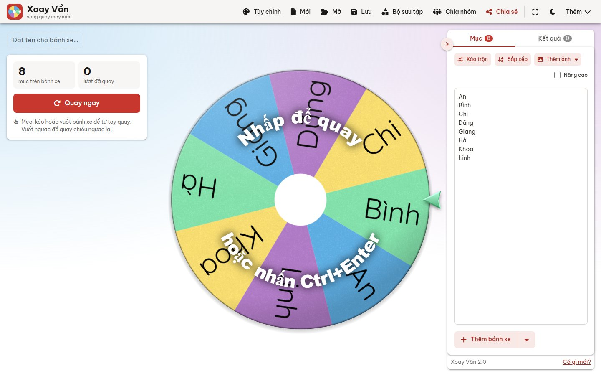
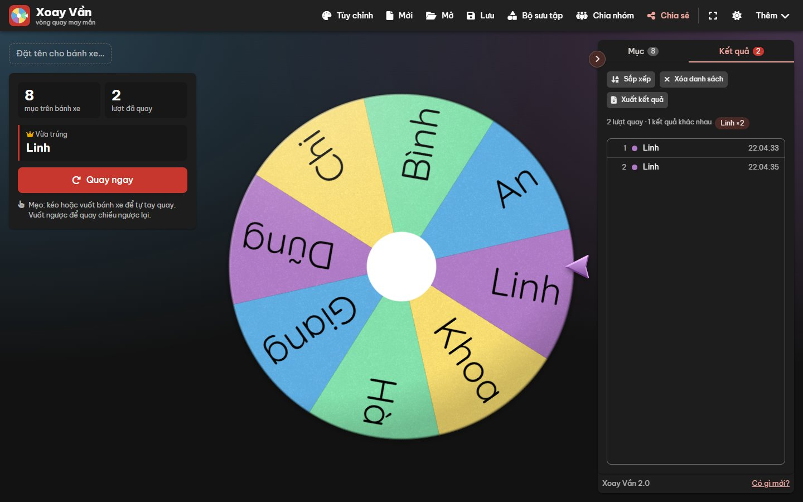
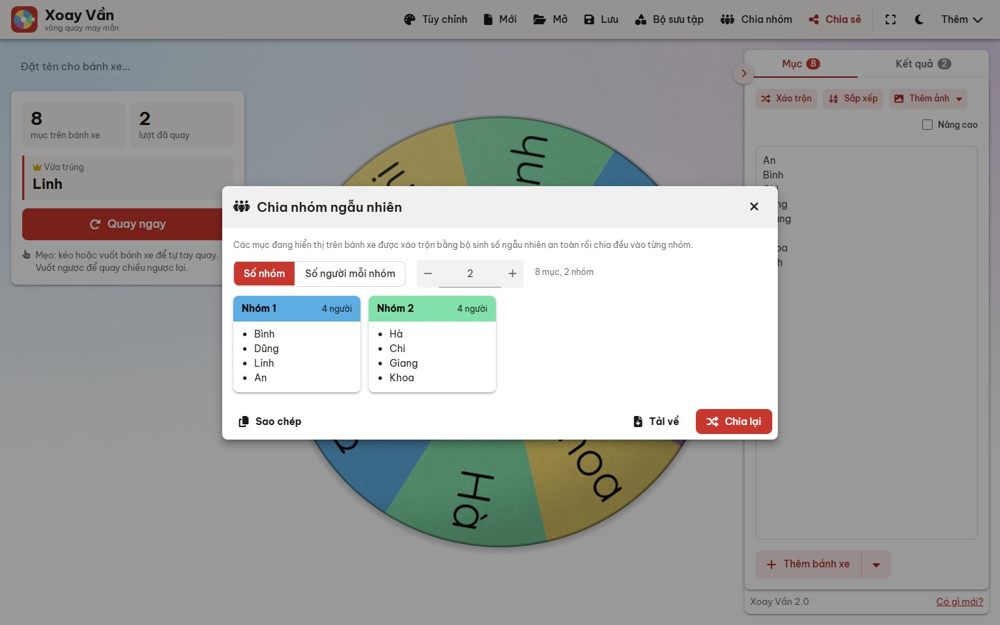
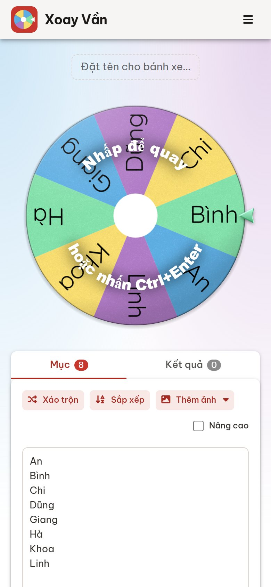

# Xoay Vần

Vòng quay may mắn công bằng và đơn giản, chạy hoàn toàn trên trình duyệt. Không quảng cáo, không đăng nhập, không máy chủ: dữ liệu của bạn chỉ nằm trên máy bạn.



## Tính năng

- **Quay theo cách bạn thích:** bấm vào bánh xe, nhấn `Ctrl + Enter`, hoặc kéo/vuốt bánh xe bằng chuột hay ngón tay. Vuốt ngược để quay chiều ngược lại.
- **Công bằng, kiểm chứng được:** góc dừng lấy từ `crypto.getRandomValues()`. Công cụ "Kiểm tra độ ngẫu nhiên" chạy 10.000–500.000 lượt quay mô phỏng bằng đúng vật lý của bánh xe và tính χ².
- **Chia nhóm ngẫu nhiên:** theo số nhóm hoặc số người mỗi nhóm, kích thước các nhóm chênh nhau tối đa 1 người; sao chép hoặc tải về.
- **Kết quả có giờ và thống kê:** số lượt quay, số kết quả khác nhau, ai trúng nhiều lần; nút "Quay tiếp" ngay trong cửa sổ người thắng.
- **Nhiều bánh xe:** tối đa 10 bánh xe trên một trang, quay tất cả một lượt.
- **Chế độ Nâng cao:** trọng số, màu riêng, ảnh, ẩn mục, âm thanh và thông báo riêng cho từng mục.
- **94 bảng màu**, trong đó có 12 bảng "Bản sắc Việt" (Tết, Hội An, Sơn mài, Áo dài, Gốm Bát Tràng…), và **14 phông chữ** hiển thị tiếng Việt chuẩn dấu.
- **Âm thanh tự tổng hợp** bằng Web Audio (không tải tệp âm thanh), pháo giấy, đọc to tên người thắng.
- **Lưu và chia sẻ:** lưu trong trình duyệt hoặc thành tệp `.wheel`; liên kết chia sẻ chứa sẵn bánh xe đã nén, kèm **mã QR** để mở trên điện thoại.
- **Nhập bảng tính:** dán cột từ Excel/Google Sheets hoặc mở tệp CSV, kể cả cột trọng số.
- **Cài như ứng dụng (PWA)** và dùng được khi offline; giao diện sáng/tối; tiếng Việt và tiếng Anh.

| Giao diện tối | Chia nhóm | Điện thoại |
| --- | --- | --- |
|  |  |  |

## Chạy thử

Không cần cài gói nào, chỉ cần Node.js 18 trở lên:

```bash
npm start              # http://localhost:5173
node server.mjs 8080   # hoặc chọn cổng khác
```

Bất kỳ máy chủ tĩnh nào cũng chạy được. Service worker (để dùng offline) chỉ hoạt động qua `http(s)`, không hoạt động khi mở tệp bằng `file://`.

## Đưa lên GitHub Pages

Vào **Settings → Pages**, chọn **Deploy from a branch**, nhánh `main`, thư mục `/ (root)`. Không cần bước build.

## Phím tắt

| Phím | Tác dụng |
| --- | --- |
| `Ctrl + Enter` | Quay tất cả bánh xe |
| `Enter` / `Space` | Quay bánh xe đang được chọn |
| `Ctrl + S` / `Ctrl + O` | Lưu / mở bánh xe |
| `F` | Bật/tắt toàn màn hình |
| `?` | Hiện bảng phím tắt |

## Tham số URL và nhúng

Mở trang với sẵn dữ liệu, ví dụ `?entries=An,Bình,Chi&title=Lớp%2010A1&spinTime=5&lang=en`. Các tham số khác: `description`, `winnerMessage`, `displayWinnerDialog=false`, `colors=#D9432F,#F4B23E`, `pageBackgroundColor`, `pageGradient=false`, `removeBackground=true`, `centerImage`, `centerSize`, `backgroundImage`, `confetti=false`.

Khi nhúng bằng `<iframe>`, trang nhận lệnh qua `postMessage`: `{ name: 'spin' }`, `{ name: 'setEntries', entries: ['An', 'Bình'] }`, `closeWinnerDialog`, `removeWinner`, `removeWinnerAll`, `hideWinner`.

## Cấu trúc mã nguồn

```
index.html            giao diện và các hộp thoại
css/app.css           toàn bộ style (sáng/tối)
js/wheel.js           vẽ bánh xe trên canvas, vật lý quay, kéo/vuốt
js/app.js             trạng thái, bố cục, luồng quay, cửa sổ người thắng, kết quả
js/editor.js          khung nhập mục, chế độ Nâng cao, nhiều bánh xe
js/dialogs.js         Tùy chỉnh, Mở/Lưu, Chia sẻ (QR), Bộ sưu tập, Nhập bảng tính, Kiểm tra độ ngẫu nhiên
js/features.js        Chia nhóm, phím tắt, đổi sáng/tối, phông chữ, service worker
js/audio.js           âm thanh tổng hợp (Web Audio)
js/confetti.js        pháo giấy
js/data.js            bảng màu, âm thanh, phông chữ, mẫu trong bộ sưu tập
js/i18n.js, i18n-en.js  tiếng Việt / tiếng Anh
sw.js, manifest.webmanifest  cài đặt như ứng dụng và chạy offline
```

## Hiệu năng

Mỗi khung hình chỉ vẽ ba ảnh đã dựng sẵn: mặt bánh xe (dựng lại khi đổi danh sách hay màu), lớp bóng và ánh sáng tĩnh, và kim chỉ (lưu sẵn theo từng màu). Canvas khớp đúng kích thước hiển thị, vật lý chạy cố định 60 Hz và chỉ vẽ khi bánh xe thực sự chuyển động. Vòng quay chậm lúc chờ chạy ở 30 khung hình/giây, tạm dừng khi bánh xe ra khỏi màn hình, và tắt hẳn khi hệ điều hành bật "giảm chuyển động".

---

## English

**Xoay Vần** ("turn and turn about") is a free, simple and fair random wheel spinner that runs entirely in the browser: no ads, no sign-in, no server. Spin by clicking, with `Ctrl + Enter`, or by dragging/flicking the wheel (flick backwards to spin the other way). The stopping angle comes from `crypto.getRandomValues()`, and a built-in χ² audit lets anyone verify fairness. It also splits people into random teams, keeps timestamped results with stats, supports up to 10 wheels, weights, images, 94 color palettes, 14 fonts with full Vietnamese diacritics, synthesized sounds, share links with QR codes, spreadsheet import, offline use as an installable app, light/dark themes, and Vietnamese/English.

Run it with `npm start` (Node.js 18+, no dependencies) or serve the folder with any static server.
